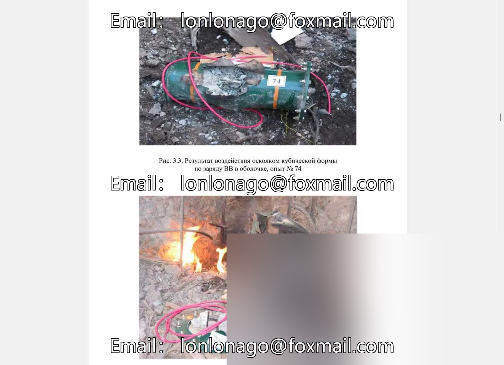
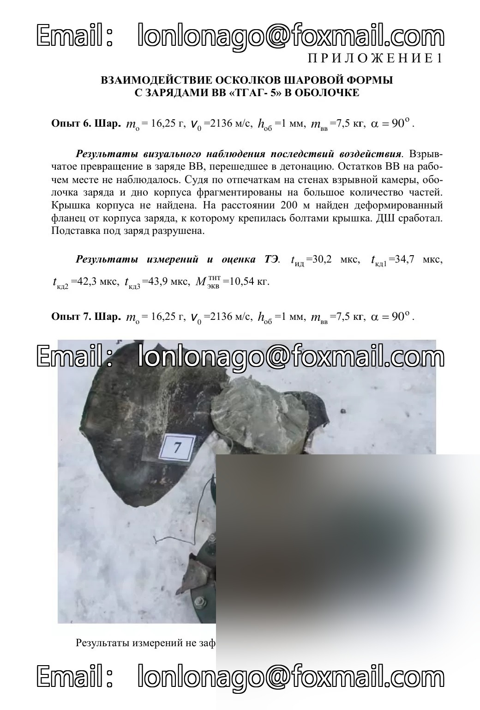
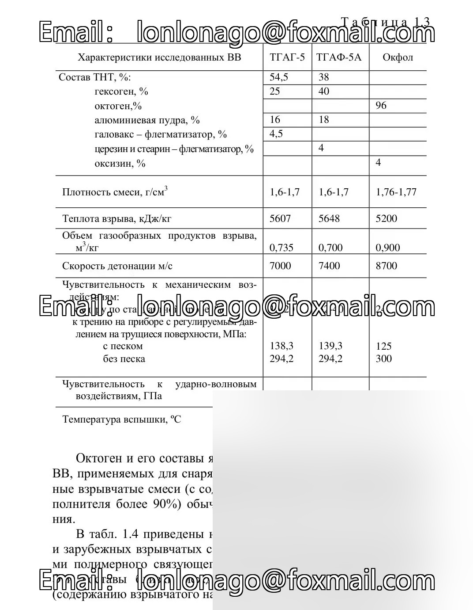
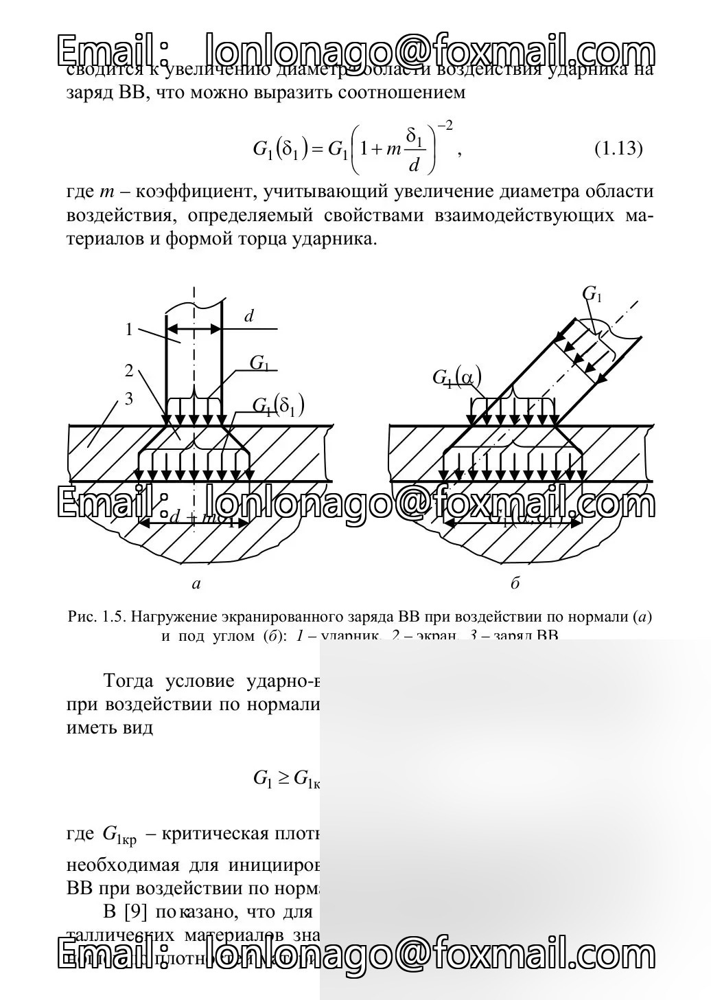
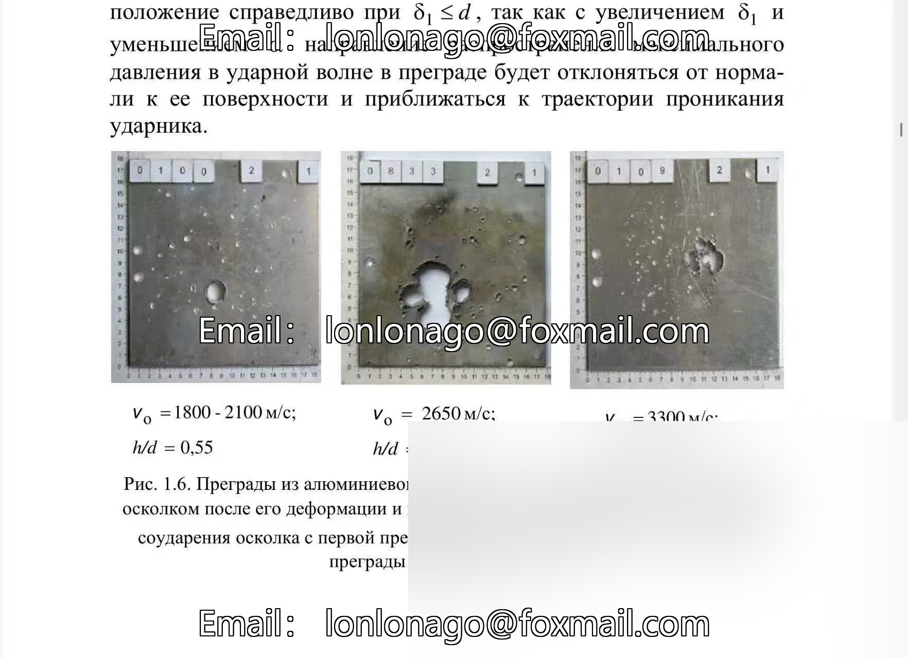
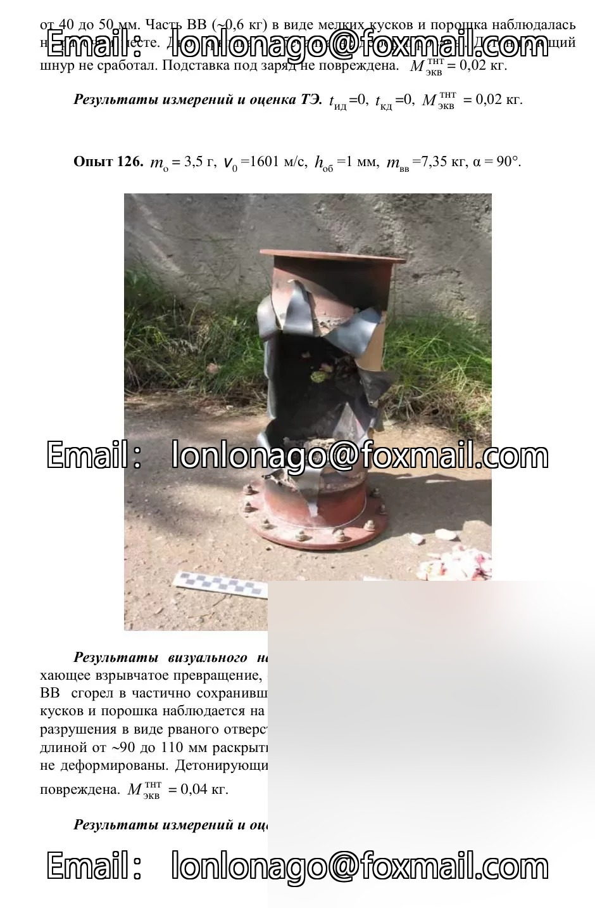

# Anti-aircraft missile combat unit detonation and ignition effect, Russian electronic edition textbook, 2009 Saint-Pierre

## Body

Effect of detonation and ignition on air defense missile combat module, Russian electronic textbook edition, published in Saint Petersburg in 2009, edited by V.M. Kamina.

The content covers the initiation principle, ignition mechanism, and structure and function of anti-aircraft missile combat pods, suitable for reference in military specialized fields, weapons system research, and anti-missile defense.

upon sale. Need to directly take photos; communicate issues privately.

This is a Russian textbook covering the detonation principles, ignition mechanisms, combat-section structure and function of air defense missiles, suitable for military professionals, weapon system research and counter-deterrence defense.

<!-- AI_ENRICHED -->

## Images

## Payment

Here is a pay link on Stripe ( https://buy.stripe.com/3cs8yP7sY87d0vu9AB ). Please contact me lonlonago@foxmail.com after funding $89, and I will send you a complete data files , thank you!

